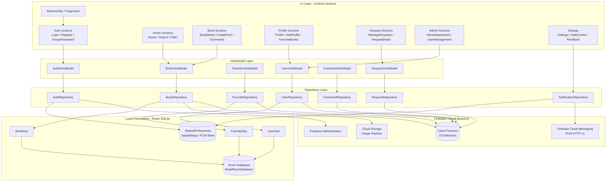
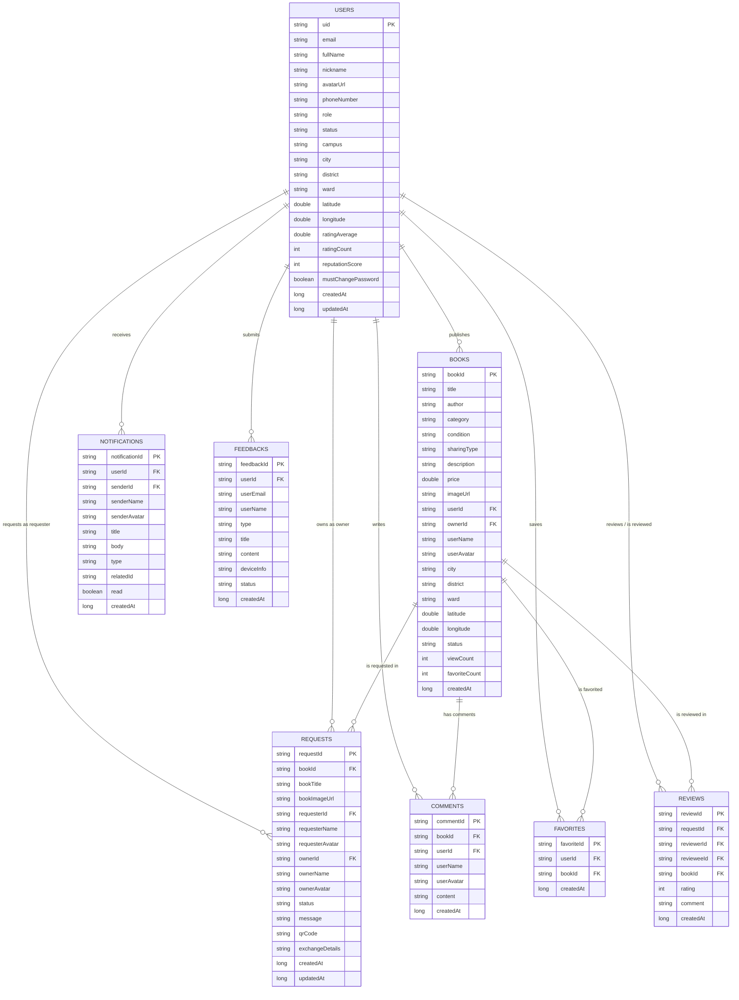

# Sơ đồ Kiến trúc Hệ thống & ERD - BookShare
**Tài liệu Thiết kế Kiến trúc & Cơ sở Dữ liệu thực tế của ứng dụng UEH BookShare**

---

## 1. Kiến trúc hệ thống tổng thể

BookShare là ứng dụng Android xây dựng theo mô hình kiến trúc `MVVM + Repository Pattern + Room Cache + Cloud Backend`. Mỗi tầng có nhiệm vụ rõ ràng:

- `UI Layer` chịu trách nhiệm hiển thị màn hình, tương tác người dùng và gọi các `ViewModel`.
- `ViewModel` xử lý state, phản ứng thay đổi dữ liệu và điều phối logic nghiệp vụ.
- `Repository Layer` là lớp trung tâm của hệ thống, đóng vai trò trung gian giữa dữ liệu cục bộ và dữ liệu đám mây.
- `Local Data Layer` dùng `Room` để lưu cache dữ liệu chính và hỗ trợ offline-first.
- `Cloud Backend` dùng `Firebase Authentication`, `Cloud Firestore`, `FCM`, `Cloud Storage` để lưu trữ, xác thực và đồng bộ dữ liệu.



### 1.1. Cấu trúc thực tế trong mã nguồn

Dự án hiện tại triển khai theo package chính như sau:

- `app/src/main/java/vn/edu/ueh/rtmiue20/project/ui/`
  - `auth/` : login, register, forgot password
  - `home/` : home, search, filter, book list
  - `book/` : book detail, create post, comments
  - `profile/` : profile, edit profile, favorite list
  - `request/` : manage request, request detail
  - `admin/` : admin dashboard, user management
  - `favorite/` : favorite screen logic
  - `base/` : base UI classes

- `app/src/main/java/vn/edu/ueh/rtmiue20/project/data/`
  - `local/` : `BookRoomDatabase`, `BookDao`, `FavoriteDao`, `UserDao`
  - `model/` : các model dữ liệu ứng với sách, user, request, comment, notification
  - `repository/` : `AuthRepository`, `BookRepository`, `FavoriteRepository`, `RequestRepository`, `CommentRepository`, `UserRepository`, `NotificationRepository`

- `app/src/main/java/vn/edu/ueh/rtmiue20/project/util/`
  - tiện ích: định dạng, GPS, tính khoảng cách, helper

### 1.2. Mô tả tầng chức năng

1. `UI Layer`
   - Hiển thị dữ liệu, trạng thái loading/error, feedback của người dùng.
   - Tương tác với `ViewModel` thông qua `LiveData` / `StateFlow` hoặc callback tương ứng tùy cấu trúc riêng từng module.
   - Hỗ trợ giao diện `Material Design 3`, chế độ ngang `layout-land`, responsive với màn hình lớn.

2. `Repository Layer`
   - Là lớp trung tâm truy xuất dữ liệu.
   - Cung cấp dữ liệu cho `ViewModel` và xử lý logic sync giữa Room và Firestore.
   - Thường làm các nhiệm vụ như:
     - đọc cache local trước
     - đọc dữ liệu từ Firestore nếu cần
     - cập nhật local cache sau khi thành công
     - xử lý lỗi mạng, fallback dữ liệu và ghi queue đồng bộ

3. `Room Database Layer`
   - Dùng `BookRoomDatabase` với version `9`.
   - `BookDao`, `FavoriteDao`, `UserDao` là các DAO truy vấn nhanh.
   - Hỗ trợ offline-first: app có thể hiển thị dữ liệu sách, favorites, profile ngay mà không cần mạng.

4. `Firebase Cloud Layer`
   - `Firebase Authentication`: đăng nhập/đăng ký, Google Sign-In, reset password.
   - `Firestore`: lưu dữ liệu người dùng, sách, request, comments, favorites, notifications, reviews, feedbacks.
   - `FCM`: gửi thông báo real-time đến người dùng khi có request, comment, accept/reject, review.
   - `Cloud Storage`: lưu ảnh bìa sách, avatar, hình ảnh chia sẻ.

---

## 2. Sơ đồ quan hệ thực thể (ERD)



### 2.1. Quan hệ dữ liệu theo hệ thống thực tế

- `users` là trung tâm: mỗi người dùng có thể đăng nhiều sách, gửi nhiều request, nhận nhiều thông báo, viết nhiều comment, lưu nhiều favorite.
- `books` liên kết với `requests` theo quan hệ một-nhiều: một cuốn sách có thể được request nhiều lần theo các trạng thái khác nhau.
- `comments` gắn trực tiếp với `bookId`, không lưu trong `books` như một embedded object.
- `favorites` dùng pattern `favoriteId = {userId}_{bookId}` để tránh trùng lặp.
- `reviews` gắn với `requestId` để đánh giá sau giao dịch, phục vụ cho hệ thống Reputation.
- `notifications` dùng để push event đến người dùng theo hành động trong app.

---

## 3. Chi tiết 8 collections trên Cloud Firestore

### 3.1. Collection `users`
`users/{userId}`

Quản lý hồ sơ người dùng, quyền truy cập, hồ sơ cá nhân và điểm uy tín.

- `uid`: ID của người dùng từ Firebase Auth
- `email`: email đăng nhập
- `fullName`: họ tên đầy đủ
- `nickname`: tên hiển thị
- `avatarUrl`: ảnh đại diện
- `phoneNumber`: số điện thoại
- `role`: `user` / `admin`
- `status`: `active` / `locked` / `banned`
- `campus`: cơ sở UEH
- `city`, `district`, `ward`: địa chỉ người dùng
- `latitude`, `longitude`: vị trí GPS
- `ratingAverage`: điểm đánh giá trung bình
- `ratingCount`: số lượng đánh giá
- `reputationScore`: điểm uy tín
- `mustChangePassword`: bắt buộc đổi mật khẩu
- `createdAt`, `updatedAt`: timestamp

### 3.2. Collection `books`
`books/{bookId}`

Quản lý thông tin bài đăng sách của cộng đồng.

- `bookId`: mã sách duy nhất
- `title`, `author`: tiêu đề và tác giả
- `category`: thể loại sách
- `condition`: tình trạng sách
- `sharingType`: `free` / `exchange` / `fee`
- `price`: giá bán / trao đổi (nếu có)
- `imageUrl`: ảnh bìa hoặc ảnh thực tế
- `description`: mô tả chi tiết
- `userId`, `ownerId`: ID của người đăng
- `userName`, `userAvatar`: thông tin hiển thị nhanh
- `city`, `district`, `ward`: vị trí giao dịch
- `latitude`, `longitude`: GPS của cuốn sách
- `status`: `available` / `requested` / `exchanged`
- `viewCount`, `favoriteCount`: thống kê tương tác
- `createdAt`: thời gian đăng

### 3.3. Collection `requests`
`requests/{requestId}`

Quản lý quy trình yêu cầu nhận, mượn, trao đổi, đánh giá sách.

- `requestId`: ID yêu cầu
- `bookId`: sách được yêu cầu
- `bookTitle`, `bookImageUrl`: thông tin nhanh của sách
- `requesterId`: người gửi yêu cầu
- `requesterName`, `requesterAvatar`: thông tin người yêu cầu
- `ownerId`: chủ sở hữu sách
- `ownerName`, `ownerAvatar`: thông tin chủ sở hữu
- `status`: `pending` / `accepted` / `rejected` / `completed`
- `message`: lời nhắn
- `qrCode`: mã QR xác thực giao dịch
- `exchangeDetails`: chi tiết trao đổi / hẹn gặp
- `createdAt`, `updatedAt`: thời gian

### 3.4. Collection `comments`
`comments/{commentId}`

Lưu các bình luận / câu hỏi dưới từng bài đăng sách.

- `commentId`: ID bình luận
- `bookId`: cuốn sách được bình luận
- `userId`: người bình luận
- `userName`, `userAvatar`: thông tin người gửi
- `content`: nội dung bình luận
- `createdAt`: thời gian bình luận

Quyền quản lý: chủ bình luận, chủ sách và admin có quyền xóa / xử lý.

### 3.5. Collection `favorites`
`favorites/{favoriteId}`

Lưu danh sách sách người dùng đã yêu thích.

- `favoriteId`: định dạng `userId_bookId`
- `userId`: ID người dùng
- `bookId`: ID sách yêu thích
- `createdAt`: thời điểm lưu yêu thích

### 3.6. Collection `notifications`
`notifications/{notificationId}`

Quản lý thông báo đẩy và hộp thư thông báo trong ứng dụng.

- `notificationId`: ID thông báo
- `userId`: người nhận
- `senderId`: người kích hoạt event
- `senderName`, `senderAvatar`: thông tin người gửi
- `title`: tiêu đề thông báo
- `body`: nội dung chi tiết
- `type`: `REQUEST`, `ACCEPT`, `REJECT`, `COMMENT`, `SYSTEM`
- `relatedId`: ID sách / request liên quan
- `read`: trạng thái đã đọc
- `createdAt`: thời gian phát thông báo

### 3.7. Collection `reviews`
`reviews/{reviewId}`

Lưu đánh giá sau giao dịch và góp phần vào độ uy tín của mỗi người dùng.

- `reviewId`: ID đánh giá
- `requestId`: request liên quan
- `reviewerId`: người chấm điểm
- `revieweeId`: người được chấm điểm
- `bookId`: cuốn sách được giao dịch
- `rating`: sao từ 1 đến 5
- `comment`: nhận xét chi tiết
- `createdAt`: thời gian đánh giá

### 3.8. Collection `feedbacks`
`feedbacks/{feedbackId}`

Lưu ý kiến đóng góp, báo lỗi, góp ý từ người dùng.

- `feedbackId`: ID feedback
- `userId`: người gửi
- `userEmail`, `userName`: thông tin người gửi
- `type`: `suggestion` / `bug` / `content` / `other`
- `title`: tiêu đề góp ý
- `content`: nội dung phản hồi
- `deviceInfo`: mô hình thiết bị, SDK, phiên bản
- `status`: `pending` / `reviewed` / `resolved`
- `createdAt`: thời gian gửi

---

## 4. Cấu trúc Room SQLite offline

Để đảm bảo nguyên tắc `Offline-First`, ứng dụng dùng `Room Database` với version 9.

### 4.1. Tầng local: `BookRoomDatabase`
- Dùng để tạo và quản lý cơ sở dữ liệu local SQLite.
- Dùng cho cache dữ liệu để tương tác nhanh khi mất mạng.
- Có thể tự đồng bộ khi Internet ổn định.

### 4.2. Dao chính
- `BookDao`
  - truy vấn danh sách sách
  - tìm sách theo ID
  - insert/update sách cache

- `FavoriteDao`
  - kiểm tra một sách có đang favorite không
  - lấy danh sách favorite theo user
  - insert / delete favorite

- `UserDao`
  - lấy thông tin user đang đăng nhập
  - insert / update profile local

### 4.3. Mục tiêu của local database
- tải profile nhanh ngay khi mở app
- hiển thị sách đã xem / đã lưu trước đó
- giảm độ trễ khi người dùng đang ở chế độ không mạng
- hỗ trợ đồng bộ dữ liệu sau khi recovered connectivity

---

## 5. Cơ chế đồng bộ dữ liệu

```text
[Người dùng tương tác]
        |
        |---> (1) Cập nhật dữ liệu local trong Room ngay lập tức
        |
        |---> (2) Gửi request tới Repository / Firestore
                     |
                     +--> Thành công: lưu thành công, cập nhật UI
                     |
                     +--> Thất bại: giữ cache local, retry hoặc chờ đồng bộ khi có mạng
```

### 5.1. Luồng dữ liệu điển hình

1. Người dùng mở app, xem sách / profile / request.
2. App ưu tiên lấy dữ liệu từ `Room` nếu có sẵn.
3. Nếu cần dữ liệu mới, Repository gọi Firestore.
4. Sau khi Firestore trả về, dữ liệu được cập nhật lên local cache.
5. Khi người dùng thao tác như tạo sách, yêu cầu, comment, favorite, app update local lần đầu, sau đó sync lên Firestore.
6. Nếu mất mạng, hệ thống vẫn chạy bằng cache local và đồng bộ lại khi kết nối trở lại.

### 5.2. Yếu tố kỹ thuật hỗ trợ
- `Firebase Authentication` cho xác thực tài khoản người dùng.
- `Firestore Security Rules` cho kiểm soát truy cập dữ liệu theo role và ownership.
- `FCM` cho notification push real-time.
- `Glide` hoặc image pipeline để tải ảnh hiệu quả từ Cloud Storage.

---

## 6. Tổng kết kiến trúc

BookShare đang vận hành theo mô hình kiến trúc hiện đại và phù hợp với ứng dụng mobile thực tế:

- `MVVM` để tách UI và logic nghiệp vụ
- `Repository Pattern` để trung tâm hóa xử lý dữ liệu
- `Room` để tối ưu offline-first
- `Firestore` để lưu trữ dữ liệu phân tán thời gian thực
- `Firebase Auth + FCM + Storage` để xử lý xác thực, thông báo và ảnh

Như vậy, hệ thống hợp nhất được cả trải nghiệm người dùng mượt mà, tính bảo mật, khả năng hoạt động offline và khả năng mở rộng trong tương lai.

---

## 7. Tài liệu tham khảo nhanh

- `README.md` : tổng quan dự án và tính năng chính
- `docs/srs.md` : đặc tả yêu cầu phần mềm
- `docs/wireframes/wireframes-overview.md` : sơ đồ luồng màn hình
- `docs/weekly-reports/` : báo cáo tiến độ theo tuần

---
