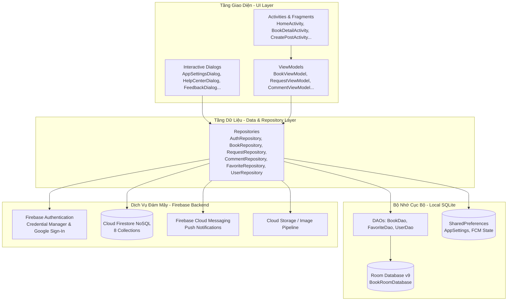
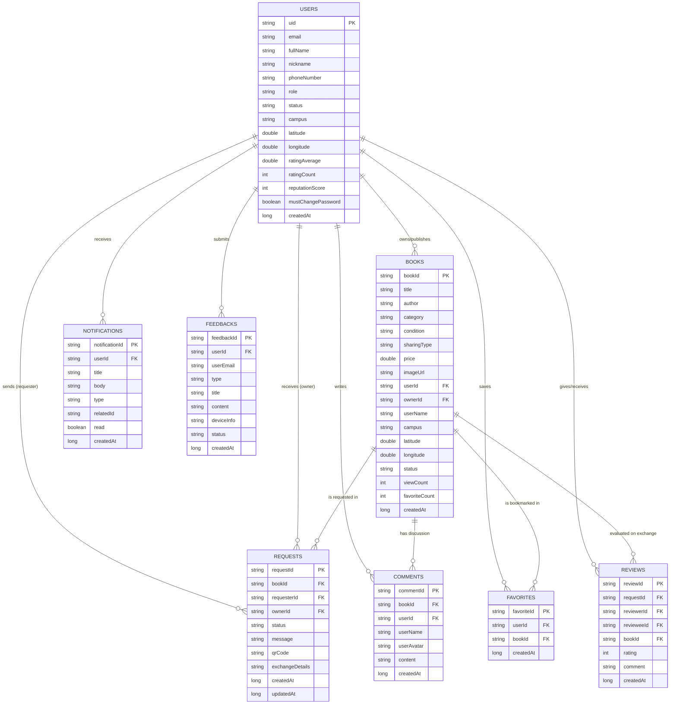

# Sơ đồ Kiến trúc Hệ thống & ERD - BookShare
**Tài liệu Thiết kế Kiến trúc & Cơ sở Dữ liệu Ứng dụng UEH BookShare**

---

## 1. Kiến trúc Hệ thống Tổng thể (System Architecture)

BookShare được xây dựng trên nền tảng **MVVM (Model - View - ViewModel)** kết hợp với **Repository Pattern**, bảo đảm tính độc lập giữa giao diện người dùng và tầng dữ liệu, đồng thời hỗ trợ khả năng mở rộng, kiểm thử và vận hành ngoại tuyến (Offline-First).



### Các thành phần chính trong kiến trúc:
1. **UI Layer (`ui/`)**:
   - `auth/`: `LogInActivity`, `RegisterActivity`, `ForgotPasswordActivity`.
   - `home/`: `HomeActivity`, `BookAdapter`, `NotificationAdapter`, `BookViewModel`.
   - `book/`: `BookDetailActivity`, `CreatePostActivity`, `CommentAdapter`, `CommentViewModel`.
   - `profile/`: `ProfileActivity`, `EditProfileActivity`, `FavoriteBooksActivity`, `MyPostsActivity`.
   - `request/`: `ManageRequestsActivity`, `RequestAdapter`, `RequestViewModel`.
   - `admin/`: `AdminDashboardActivity`, `UserManagementActivity`, `UserManageAdapter`.
   - `dialog/`: `AppSettingsDialog`, `HelpCenterDialog`, `FeedbackDialog`.
2. **Repository Layer (`data/repository/`)**:
   - Quản trị luồng dữ liệu, làm cầu nối đồng bộ giữa Room Database cục bộ và Cloud Firestore.
   - Xử lý cache-first khi tải sách yêu thích và fallback khi rớt mạng.
3. **Local Database Layer (`data/local/`)**:
   - Quản lý cơ sở dữ liệu SQLite cục bộ qua **Android Room v9** (`BookRoomDatabase`).
   - Cung cấp các DAO: [BookDao](file:///d:/AndroidStudioProject/Project/app/src/main/java/vn/edu/ueh/rtmiue20/project/data/local/BookDao.java), [FavoriteDao](file:///d:/AndroidStudioProject/Project/app/src/main/java/vn/edu/ueh/rtmiue20/project/data/local/FavoriteDao.java), [UserDao](file:///d:/AndroidStudioProject/Project/app/src/main/java/vn/edu/ueh/rtmiue20/project/data/local/UserDao.java).
4. **Backend Cloud Services**:
   - **Firebase Authentication**: Quản lý phiên đăng nhập, tích hợp Google Credential Manager API.
   - **Cloud Firestore**: Cơ sở dữ liệu NoSQL phân tán thời gian thực gồm **8 collections**.
   - **Firebase Cloud Messaging (FCM)**: Gửi thông báo đẩy đến người dùng.

---

## 2. Sơ đồ Quan hệ Thực thể (ERD Diagram)



---

## 3. Chi tiết 8 Collections trên Cloud Firestore

### 3.1. Collection `users` (`users/{userId}`)
Quản lý thông tin hồ sơ người dùng, phân quyền và điểm số uy tín.
- `uid` (String, PK): Mã định danh duy nhất từ Firebase Auth.
- `fullName` (String): Họ và tên đầy đủ của người dùng.
- `nickname` (String): Tên người dùng hiển thị (tự động tạo hoặc tùy chỉnh).
- `email` (String): Địa chỉ email đăng ký.
- `avatarUrl` (String): Đường dẫn ảnh đại diện.
- `phoneNumber` (String): Số điện thoại liên lạc.
- `role` (String): `"user"` hoặc `"admin"`.
- `status` (String): `"active"`, `"locked"`, hoặc `"banned"`.
- `campus` (String): Cơ sở học tập (mặc định: "Cơ sở B - 279 Nguyễn Tri Phương, Quận 10").
- `city`, `district`, `ward` (String): Địa chỉ khu vực sinh sống.
- `latitude`, `longitude` (Double): Tọa độ địa lý GPS dùng tính khoảng cách.
- `ratingAverage` (Double): Điểm đánh giá trung bình (1.0 đến 5.0 sao).
- `ratingCount` (Integer): Tổng số lượt đánh giá nhận được.
- `reputationScore` (Integer): Điểm uy tín cộng dồn từ các giao dịch thành công.
- `mustChangePassword` (Boolean): Cờ bắt buộc đổi mật khẩu khi vừa được Admin cấp lại.
- `createdAt`, `updatedAt` (Long): Dấu thời gian tạo và cập nhật.

### 3.2. Collection `books` (`books/{bookId}`)
Quản lý các bài đăng chia sẻ sách trong cộng đồng.
- `bookId` (String, PK): Mã sách duy nhất tạo ngẫu nhiên.
- `title` (String): Tên sách.
- `author` (String): Tác giả cuốn sách.
- `category` (String): Thể loại sách (Văn học, Kinh tế, Giáo trình, Công nghệ, Kỹ năng...).
- `condition` (String): Tình trạng sách (Mới 100%, 95%, 80%, Cũ).
- `sharingType` (String): `"free"` (Tặng), `"exchange"` (Trao đổi), `"fee"` (Bán lại).
- `price` (Double): Giá bán lại (nếu hình thức chia sẻ là có phí).
- `imageUrl` (String): Đường dẫn hình ảnh sách bìa thực tế.
- `description` (String): Mô tả nội dung cuốn sách.
- `userId` / `ownerId` (String, FK): ID của thành viên đăng sách.
- `userName`, `userAvatar` (String): Thông tin người đăng hiển thị nhanh.
- `city`, `district`, `ward` (String): Địa chỉ giao dịch sách.
- `latitude`, `longitude` (Double): Tọa độ vị trí cuốn sách.
- `status` (String): `"available"` (Còn sách), `"requested"` (Đang có yêu cầu), `"exchanged"` (Đã trao đổi).
- `viewCount` (Integer): Lượt xem bài viết.
- `favoriteCount` (Integer): Số lượt yêu thích bài viết.
- `createdAt` (Long): Thời gian đăng bài.

### 3.3. Collection `requests` (`requests/{requestId}`)
Quản lý quy trình mượn, nhận và trao đổi sách giữa hai bên.
- `requestId` (String, PK): Mã yêu cầu.
- `bookId` (String, FK): Mã cuốn sách được yêu cầu.
- `bookTitle`, `bookImageUrl` (String): Thông tin nhanh của cuốn sách.
- `requesterId` (String, FK): ID của thành viên gửi yêu cầu xin/đổi sách.
- `requesterName`, `requesterAvatar` (String): Thông tin thành viên yêu cầu.
- `ownerId` (String, FK): ID của chủ sở hữu cuốn sách.
- `ownerName`, `ownerAvatar` (String): Thông tin chủ sở hữu cuốn sách.
- `status` (String): `"pending"` (Chờ duyệt), `"accepted"` (Đã đồng ý), `"rejected"` (Từ chối), `"completed"` (Hoàn thành).
- `message` (String): Lời nhắn gửi kèm từ người xin sách.
- `qrCode` (String): Chuỗi mã QR Code xác thực khi giao nhận sách.
- `exchangeDetails` (String): Thỏa thuận trao đổi hoặc thông tin địa điểm hẹn.
- `createdAt`, `updatedAt` (Long): Dấu thời gian.

### 3.4. Collection `comments` (`comments/{commentId}`)
Quản lý các thảo luận, hỏi đáp công khai dưới từng cuốn sách.
- `commentId` (String, PK): Mã bình luận.
- `bookId` (String, FK): Mã sách được bình luận (dùng làm khóa ngoại truy vấn).
- `userId` (String, FK): ID của thành viên viết bình luận.
- `userName`, `userAvatar` (String): Thông tin người bình luận tại thời điểm đăng.
- `content` (String): Nội dung bình luận (tối đa 1,000 ký tự).
- `createdAt` (Long): Thời gian gửi bình luận.
*(Quy tắc phân quyền: Chủ bình luận, Chủ cuốn sách hoặc Admin có quyền xóa)*.

### 3.5. Collection `favorites` (`favorites/{favoriteId}`)
Quản lý danh mục bài viết yêu thích của từng người dùng.
- `favoriteId` (String, PK): Đặt theo quy ước `{userId}_{bookId}` để chống trùng lặp.
- `userId` (String, FK): ID thành viên lưu yêu thích.
- `bookId` (String, FK): ID cuốn sách được lưu.
- `createdAt` (Long): Thời gian nhấn yêu thích.

### 3.6. Collection `notifications` (`notifications/{notificationId}`)
Quản lý thông báo đẩy và hộp thư thông báo trong ứng dụng.
- `notificationId` (String, PK): Mã thông báo.
- `userId` / `recipientId` (String, FK): ID người nhận thông báo.
- `senderId` (String, FK): ID người gửi hành động kích hoạt thông báo.
- `senderName`, `senderAvatar` (String): Thông tin người kích hoạt.
- `title` (String): Tiêu đề thông báo.
- `body` (String): Nội dung chi tiết thông báo.
- `type` (String): `"REQUEST"`, `"ACCEPT"`, `"REJECT"`, `"COMMENT"`, `"SYSTEM"`.
- `relatedId` (String): ID của cuốn sách hoặc yêu cầu liên quan để điều hướng.
- `read` (Boolean): Trạng thái đã đọc hay chưa đọc.
- `createdAt` (Long): Thời gian phát thông báo.

### 3.7. Collection `reviews` (`reviews/{reviewId}`)
Quản lý các đánh giá chất lượng sách và độ uy tín của người dùng sau giao dịch.
- `reviewId` (String, PK): Mã đánh giá.
- `requestId` (String, FK): Mã yêu cầu giao dịch tương ứng.
- `reviewerId` (String, FK): ID của người chấm điểm.
- `revieweeId` (String, FK): ID của người được chấm điểm.
- `bookId` (String, FK): ID cuốn sách được giao dịch.
- `rating` (Integer): Điểm số đánh giá từ 1 đến 5 sao.
- `comment` (String): Lời nhận xét chi tiết.
- `createdAt` (Long): Thời gian tạo đánh giá.

### 3.8. Collection `feedbacks` (`feedbacks/{feedbackId}`)
Lưu trữ ý kiến đóng góp, báo lỗi từ sinh viên gửi đến đội ngũ phát triển/Admin.
- `feedbackId` (String, PK): Mã phản hồi.
- `userId` (String, FK): ID của người gửi phản hồi.
- `userEmail`, `userName` (String): Thông tin liên hệ của người gửi.
- `type` (String): `"suggestion"`, `"bug"`, `"content"`, `"other"`.
- `title` (String): Tiêu đề góp ý.
- `content` (String): Nội dung phản hồi chi tiết (tối đa 2,000 ký tự).
- `deviceInfo` (String): Tên model máy, phiên bản Android SDK hỗ trợ gỡ lỗi.
- `status` (String): `"pending"`, `"reviewed"`, `"resolved"`.
- `createdAt` (Long): Thời gian gửi góp ý.

---

## 4. Cấu trúc Cơ sở Dữ liệu Ngoại tuyến Room SQLite (Phiên bản 9)

Để đảm bảo nguyên tắc **Offline-First**, BookShare triển khai [BookRoomDatabase](file:///d:/AndroidStudioProject/Project/app/src/main/java/vn/edu/ueh/rtmiue20/project/data/local/BookRoomDatabase.java) với phiên bản schema **Version 9**:

### 4.1. Bảng `books` (Entity `Book.java`)
- Chứa toàn bộ dữ liệu bài đăng sách đã xem hoặc đã lưu vào bộ nhớ máy.
- Lưu trữ các trường tọa độ GPS (`latitude`, `longitude`) và địa chỉ hành chính (`city`, `district`, `ward`) hỗ trợ tính khoảng cách ngay cả khi mất kết nối mạng.
- [BookDao](file:///d:/AndroidStudioProject/Project/app/src/main/java/vn/edu/ueh/rtmiue20/project/data/local/BookDao.java) cung cấp các truy vấn: `getAllBooks()`, `getBookById()`, `insertBooks()`, `updateBook()`, `deleteBook()`.

### 4.2. Bảng `favorites` (Entity `Favorite.java`)
- Lưu trữ danh sách bài viết yêu thích của người dùng hiện tại trên máy.
- [FavoriteDao](file:///d:/AndroidStudioProject/Project/app/src/main/java/vn/edu/ueh/rtmiue20/project/data/local/FavoriteDao.java) cung cấp các hàm: `getFavoritesByUserId()`, `isFavorite()`, `insertFavorite()`, `deleteFavorite()`.

### 4.3. Bảng `users` (Entity `User.java`)
- Lưu trữ thông tin hồ sơ của người dùng đăng nhập hiện tại để tải giao diện tức thì không cần chờ mạng.
- [UserDao](file:///d:/AndroidStudioProject/Project/app/src/main/java/vn/edu/ueh/rtmiue20/project/data/local/UserDao.java) cung cấp các hàm: `getUserById()`, `insertUser()`.

---

## 5. Cơ chế Đồng bộ Dữ liệu (Synchronization Mechanism)

```
[Người dùng tương tác] 
         │
         ├──> (1) Cập nhật tức thì vào Room SQLite Database (UI cập nhật 0ms latency)
         │
         └──> (2) Bắn request đồng bộ lên Cloud Firestore qua Repository
                   │
                   ├──> Thành công: Ghi nhận trạng thái hoàn tất
                   │
                   └──> Thất bại (Mất mạng): Queue chờ mạng khôi phục hoặc thực hiện
                        qua nút "Đồng bộ dữ liệu Room" trong Cài đặt ứng dụng.
```
