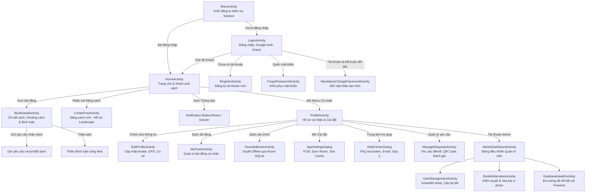

# Tổng quan Giao diện & Luồng màn hình (Wireframes & UI Flow) - BookShare
**Tài liệu Thiết kế Trải nghiệm Người dùng & Kiến trúc Màn hình Ứng dụng UEH BookShare**

---

## 1. Sơ đồ Điều hướng Người dùng Tổng thể (Overall Navigation Flow)

---

## 2. Chi tiết các Phân hệ Màn hình & Wireframe

### 2.1. Phân hệ Xác thực & Điều hướng Khởi động (Auth & Onboarding)
- **`MainActivity` (Splash Routing)**:
  - Kiểm tra trạng thái Firebase Auth Token.
  - Tự động kiểm tra cờ `status` (nếu `locked` -> cảnh báo khóa), cờ `mustChangePassword` (nếu `true` -> yêu cầu đổi mật khẩu).
  - Điều hướng tức thì sang `HomeActivity` nếu hợp lệ hoặc `LogInActivity` nếu chưa đăng nhập.
- **`LogInActivity`**:
  - Logo BookShare hiện đại với hiệu ứng gradient UEH.
  - Form nhập Email hoặc Nickname tra cứu tự động.
  - Nút bấm Đăng nhập nhanh bằng **Google Credential Manager**.
  - Nút bấm **"Xem như Khách" (Guest Mode)**: cho phép sinh viên trải nghiệm ứng dụng mà không cần đăng nhập ngay.
  - Liên kết chuyển tiếp sang `RegisterActivity` và `ForgotPasswordActivity`.
- **`RegisterActivity`**:
  - Form đăng ký với kiểm tra tính hợp lệ dữ liệu thời gian thực (Real-time Validation): Email đuôi hợp lệ, Mật khẩu >= 6 ký tự.
  - Tự động gán cơ sở mặc định: **Cơ sở B UEH (279 Nguyễn Tri Phương, Q10)**.
  - Tự động sinh Nickname độc nhất tránh trùng lặp.
- **`ForgotPasswordActivity`**:
  - Gửi email liên kết đặt lại mật khẩu bảo mật qua Firebase Authentication.

---

### 2.2. Phân hệ Trang chủ & Tìm kiếm (Home & Search)
- **`HomeActivity`**:
  - **Top App Bar**:
    - Ô tìm kiếm thời gian thực (Search view) cho phép tìm kiếm tức thì theo Tên sách hoặc Tác giả.
    - Nút chuông thông báo hiển thị **Huy hiệu số lượng chưa đọc (Badge Counter)**.
    - Avatar người dùng điều hướng nhanh đến `ProfileActivity`.
  - **Category Chips Bar**:
    - Danh sách các danh mục trượt ngang dạng Pill Chip: *Tất cả, Văn học, Kinh tế, Giáo trình, Công nghệ, Kỹ năng, Ngoại ngữ, Khác*.
    - Lọc dữ liệu mượt mà không tải lại toàn bộ trang.
  - **Danh sách sách (`RecyclerView`)**:
    - Thẻ sách Material 3 dạng CardView bo góc: Ảnh bìa sách tải qua Glide kèm placeholder và hiệu ứng mờ (shimmer/fade).
    - Huy hiệu phân loại hình thức chia sẻ: *Tặng miễn phí (Xanh lá)*, *Trao đổi (Xanh dương)*, *Bán lại (Cam)*.
    - Huy hiệu khoảng cách thực tế tính bằng km từ vị trí người dùng đến cuốn sách.
    - Nút Thả tim yêu thích với hoạt ảnh nảy mềm mại (Scale bounce) và lưu tức thì vào Room SQLite.
    - Áp dụng hiệu ứng chạm tương tác `ViewPressEffectHelper`.
  - **Floating Action Button (`+`)**:
    - Nút nổi mở màn hình Đăng bài chia sẻ sách (`CreatePostActivity`).

---

### 2.3. Phân hệ Chi tiết Sách & Tương tác Cộng đồng (Book Detail & Interaction)
- **`BookDetailActivity`**:
  - **Header Image**: Ảnh bìa kích thước lớn, hỗ trợ chạm phóng to, nút Back và nút Yêu thích góc trên.
  - **Thông tin chi tiết**: Tiêu đề sách lớn, Tên tác giả, Tình trạng (95%, Mới...), Hình thức chia sẻ, Giá tiền (nếu có).
  - **Thông tin Người đăng (Owner Card)**:
    - Ảnh đại diện, Tên người đăng, Số sao đánh giá uy tín (⭐ 4.8 / 5.0).
    - Nút bấm "Gọi điện" trực tiếp (`Intent.ACTION_DIAL`) hoặc "Xem địa điểm".
  - **Vị trí & Khoảng cách**:
    - Hiển thị địa chỉ cơ sở / khu vực cùng khoảng cách đo bằng định vị GPS Haversine.
  - **Hành động chính**:
    - Nút "Gửi yêu cầu nhận sách": Mở hộp thoại gửi tin nhắn xin sách đến chủ bài đăng.
  - **Khu vực Bình luận (Comments Section)**:
    - Danh sách bình luận công khai từ cộng đồng với avatar, tên, mốc thời gian đăng bài (Time ago).
    - Khung nhập bình luận thời gian thực có nút gửi nhanh.
    - Nút xóa bình luận (hiển thị đối với chính tác giả bình luận hoặc chủ cuốn sách).

---

### 2.4. Phân hệ Đăng bài Chia sẻ Sách (Create Post & Responsive)
- **`CreatePostActivity`**:
  - **Chế độ màn hình dọc (`activity_create_post.xml`)**:
    - Khu vực tải ảnh: Chụp trực tiếp từ Camera hoặc chọn từ Thư viện (Gallery), xem trước ảnh và xóa ảnh.
    - Form nhập Tên sách, Tác giả, Danh mục (Dropdown Spinner), Tình trạng sách.
    - Lựa chọn hình thức: *Tặng miễn phí*, *Trao đổi giáo trình*, *Bán lại*.
    - Khu vực vị trí: Tự động điền theo Cơ sở UEH đã lưu hoặc lấy vị trí GPS hiện tại.
    - Ô nhập mô tả chi tiết cuốn sách.
    - Nút "Đăng sách ngay" với hiệu ứng nạp (Loading indicator).
  - **Chế độ màn hình xoay ngang chuyên biệt (`layout-land/activity_create_post.xml`)**:
    - Phân chia bố cục cân bằng 2 cột:
      - **Cột trái**: Khung chọn và xem trước hình ảnh sách trực quan.
      - **Cột phải**: Toàn bộ biểu mẫu nhập liệu dạng ScrollView, không bị che khuất bàn phím ảo.
    - Tối ưu hóa tuyệt đối cho người dùng máy tính bảng hoặc thiết bị màn hình gập.

---

### 2.5. Phân hệ Quản lý Hồ sơ & Hộp thoại Cài đặt (Profile & Settings)
- **`ProfileActivity`**:
  - Header: Ảnh đại diện lớn, Tên người dùng, Nickname (@username), Điểm uy tín thành viên, Cơ sở UEH đang học.
  - Danh mục chức năng quản lý:
    - **Chỉnh sửa hồ sơ (`EditProfileActivity`)**: Cập nhật ảnh đại diện, số điện thoại, chọn lại Cơ sở UEH / Tọa độ.
    - **Quản lý yêu cầu (`ManageRequestsActivity`)**: Theo dõi các sách đang mượn và được yêu cầu.
    - **Sách của tôi (`MyPostsActivity`)**: Danh sách bài viết cá nhân đã đăng, chuyển đổi trạng thái "Còn sách" / "Đã trao đổi".
    - **Sách yêu thích (`FavoriteBooksActivity`)**: Danh mục sách yêu thích có khả năng xem khi không có mạng (Offline Room v9).
    - **Cài đặt ứng dụng (`AppSettingsDialog`)**:
      - Công tắc Bật/Tắt thông báo đẩy FCM.
      - Nút "Đồng bộ dữ liệu Room": Cưỡng bức kéo dữ liệu mới nhất từ Firestore về Room SQLite.
      - Nút "Xóa bộ nhớ đệm (Cache)": Xóa tệp tạm của Glide, giải phóng bộ nhớ.
    - **Trung tâm trợ giúp (`HelpCenterDialog`)**:
      - FAQ Accordion: Danh sách các câu hỏi thường gặp dạng đóng/mở (Hỏi về cách mượn sách, đăng bài, bảo mật).
      - Nút "Liên hệ hỗ trợ": Mở ứng dụng Email gửi trực tiếp tới hòm thư hỗ trợ UEH BookShare.
      - Nút "Gửi phản hồi / Góp ý": Mở `FeedbackDialog` gửi ý kiến lưu trực tiếp vào Firestore collection `feedbacks`.
    - **Đăng xuất**: Đăng xuất an toàn khỏi Firebase Auth và Google Credential Session.

---

### 2.6. Phân hệ Quy trình Giao nhận & Mã QR (Requests & QR Flow)
- **`ManageRequestsActivity`**:
  - **Tab 1: "Yêu cầu nhận được" (Dành cho chủ sách)**:
    - Danh sách sinh viên muốn xin/đổi sách của mình.
    - Nút Chấp nhận (Accept) hoặc Từ chối (Reject).
    - Sau khi chấp nhận: Xuất hiện nút "Tạo mã QR giao nhận".
  - **Tab 2: "Yêu cầu đã gửi" (Dành cho người xin sách)**:
    - Theo dõi tiến độ yêu cầu: *Chờ duyệt*, *Đã đồng ý*, *Đã hoàn tất*, *Bị từ chối*.
    - Nút "Quét / Nhập mã QR" để hoàn tất giao dịch trực tiếp tại khuôn viên UEH.
  - **Đánh giá & Chấm điểm (Review Dialog)**:
    - Sau khi quét mã xác nhận thành công, màn hình bật hộp thoại chấm điểm từ 1 đến 5 sao và viết nhận xét độ uy tín cho đối phương.

---

### 2.7. Phân hệ Quản trị Hệ thống (Admin Dashboard)
- **`AdminDashboardActivity`**:
  - Thẻ thống kê thời gian thực: Tổng số bài đăng, Sách có sẵn, Sách đã trao đổi, Tổng số thành viên, Tài khoản bị khóa.
  - **Quản lý người dùng (`UserManagementActivity`)**:
    - Danh sách tài khoản kèm thanh tìm kiếm nhanh theo Tên, Email, Nickname.
    - Thẻ thông tin hiển thị vai trò (`Role: admin/user`) và trạng thái (`Status: active/locked`).
    - Nút thao tác: Khóa tài khoản vi phạm (Lock), Mở khóa (Unlock), Cấp lại mật khẩu tạm thời (Temporary Password).
  - **Kiểm duyệt bài đăng sách (`BookModerationActivity`)**:
    - Duyệt toàn bộ kho sách, gắn cờ cảnh báo hoặc thực hiện xóa bài đăng vi phạm bản quyền / nội dung không phù hợp.
  - **Giám sát sức khỏe kết nối (`DatabaseHealthActivity`)**:
    - Kiểm tra độ trễ (Latency ping) của Cloud Firestore, báo cáo trạng thái kết nối mạng ổn định.
